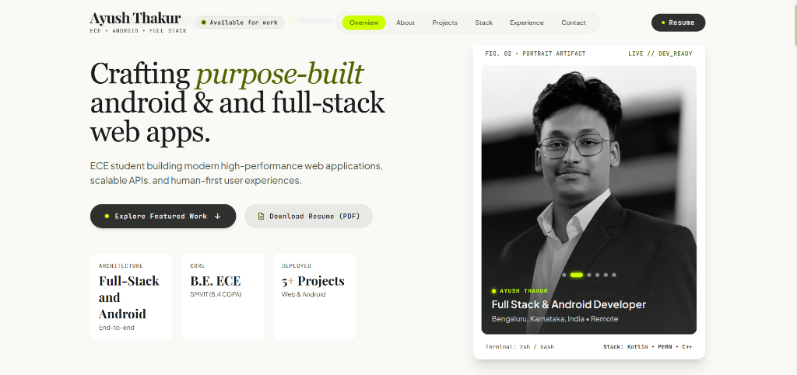

# Ayush Thakur - Portfolio

Personal portfolio site built with React + Vite.



## Stack

- React 18 + Vite
- Tailwind CSS (for utility classes) + custom design system & animations (material symbols, smooth slideshows, glowing badges, glassmorphic cards)

## Features

- 📸 **Dynamic Hero Slideshow**: Multi-photo crossfade carousel with auto-play, manual hover navigation, dot indicators, and live artifact counter.
- 💻 **Interactive Project Showcases**: Featured projects (**InterviewGen** & **Bank Transaction & Ledger System**) equipped with multi-step workflow screenshot carousels.
- ⚡ **Lightweight & High Performance**: Clean component separation, responsive design, fast Vite bundling, and optimized asset handling.

## Project structure

```
portfolio/
├── public/
│   ├── favicon.jpg
│   ├── images/
│   │   └── preview.png
│   └── resume/
│       └── AyushThakur_resume.pdf
├── src/
│   ├── assets/
│   │   └── images/
│   │       ├── profile.jpg
│   │       ├── slide1.jpg ... slide5.jpg
│   │       └── projects/
│   │           ├── interviewgen.png, interviewgen-1..4.png
│   │           ├── bank-ledger.png, bank-ledger-1..5.png
│   │           ├── blog-app.png
│   │           └── secure-auth.png
│   ├── components/
│   │   ├── layout/                     # header, footer, background — shared shell
│   │   │   ├── AnimatedBackground.jsx
│   │   │   ├── Header.jsx
│   │   │   └── Footer.jsx
│   │   ├── sections/                   # one component per page section
│   │   │   ├── Hero.jsx                # hero presentation with portrait slideshow
│   │   │   ├── About.jsx
│   │   │   ├── Skills.jsx
│   │   │   ├── Experience.jsx
│   │   │   ├── Projects.jsx
│   │   │   └── Contact.jsx
│   │   └── ui/                         # small reusable pieces
│   │       ├── Icon.jsx                # single icon component, name-driven
│   │       ├── ProjectCard.jsx         # project card with carousel & workflow preview
│   │       ├── SkillCard.jsx
│   │       └── CertCard.jsx
│   ├── data/                           # all content lives here, not in JSX
│   │   ├── profile.js                  # name, contact info, nav links
│   │   ├── education.js                # education, certifications, leadership
│   │   ├── skills.js
│   │   ├── experience.js
│   │   └── projects.js
│   ├── hooks/                          # scroll header, active-nav highlighting,
│   │   │                               # typing effect, scroll-reveal on cards
│   │   ├── useScrollHeader.js
│   │   ├── useActiveSection.js
│   │   ├── useTypingEffect.js
│   │   └── useRevealOnScroll.js
│   ├── App.jsx
│   ├── main.jsx
│   └── index.css                       # Tailwind directives + custom design system
├── index.html
├── package.json
├── vite.config.js
├── tailwind.config.js
└── postcss.config.js
```

**Why this shape:** content (`data/`) is separated from presentation
(`components/`), so updating a project, adding a certification, or fixing a
typo means editing one line in a data file — not hunting through markup.
Sections are one file each, cards are reusable, and interactive behavior
(scroll header, active-nav highlighting, typing effect, scroll-reveal on
project cards) lives in small, isolated hooks.

## Getting started

```bash
npm install
npm run dev       # local dev server, usually http://localhost:5173
npm run build     # production build -> dist/
npm run preview   # preview the production build locally
```

## Deploying to GitHub Pages (thakur-027.github.io)

This repo is a **user/org page** (`thakur-027.github.io`), which GitHub Pages
serves straight from a branch — it does not build for you, so the built
`dist/` output needs to end up on the branch GitHub Pages serves.

```bash
npm run deploy    # builds and publishes dist/ to gh-pages branch
```

## Content changes cheat sheet

| Want to change...          | Edit this file                     |
|-----------------------------|-------------------------------------|
| Name, email, phone, socials | `src/data/profile.js`              |
| Education / certifications  | `src/data/education.js`            |
| Skills grid                 | `src/data/skills.js`               |
| Work experience             | `src/data/experience.js`           |
| Projects                    | `src/data/projects.js`             |
| Resume PDF                  | replace `public/resume/AyushThakur_resume.pdf` (keep the filename, or update `resumeUrl` in `profile.js`) |
| Profile photo & slides      | replace `src/assets/images/profile.jpg` or `slide1..5.jpg` |
